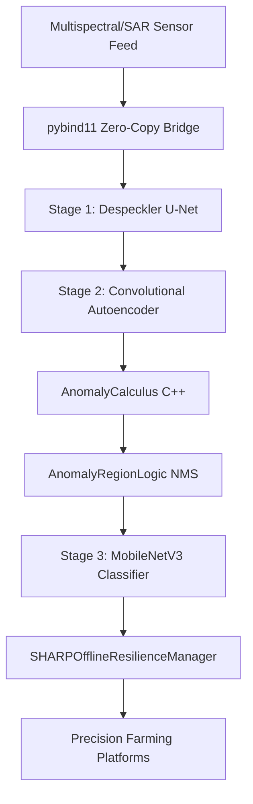
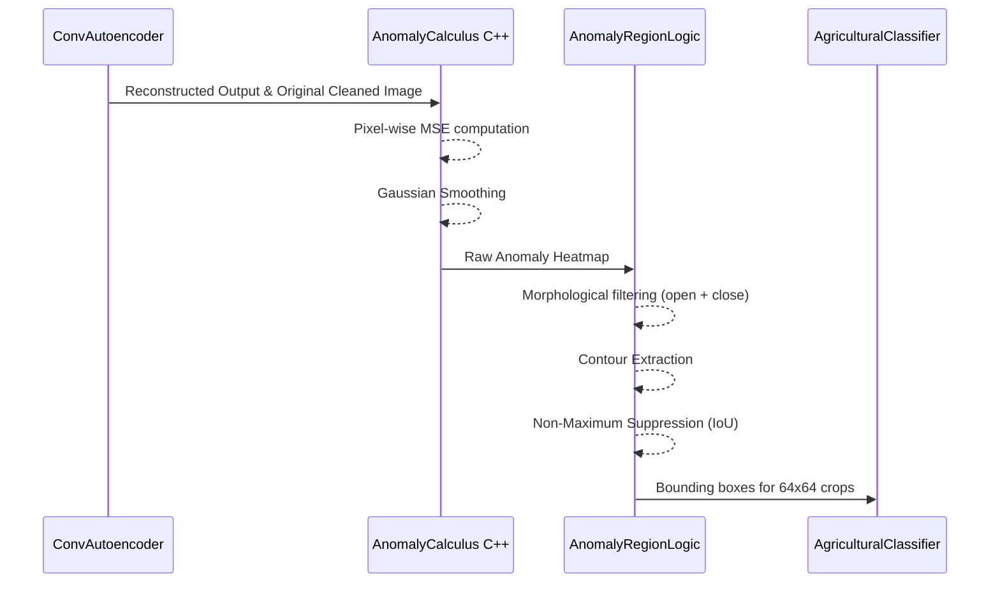

# Architecture: Drone-Based Precision Agriculture & Environmental Monitoring

> [!NOTE]
> This system uses lightweight convolutional neural networks (Despeckler U-Net, Convolutional Autoencoder, MobileNetV3) for aerial agricultural monitoring. Every model is a single forward pass, giving high-fps processing on drone edge compute (Jetson Orin Nano) with native TensorRT support.

## System Workflow



## Stage 1: Aerial Image Despeckler
Uses **DespecklerUNet** (`models/despeckler/model.py`).
- Input is multispectral bands (RGB + NIR + RedEdge) or SAR.
- 3-level encoder-decoder with skip connections; `ConvBlock` / `TransConvBlock` (Conv → BatchNorm → LeakyReLU).
- Sigmoid readout keeps output in [0, 1] and preserves field edge geometry and crop rows.
- Trained with MSE + SSIM loss.

> [!CAUTION]
> The corruption engine (`models/despeckler/corruption.py`) must be correctly parameterized for drone vibration (motion blur) and atmospheric haze, not just SAR Rayleigh/Gamma noise unless processing Sentinel-1 feeds.

## Stage 2: Crop Health Anomaly Detector
Uses **ConvAutoencoder** (`models/autoencoder/autoencoder.py`).
- Trained strictly on healthy crop canopies (zero defects).
- Reconstructs healthy spectral signatures.



## Stage 3: Agricultural Anomaly Classifier
Uses **AgriculturalClassifier** (`models/classifier/classifier.py`), a MobileNetV3-Small.
- Depthwise separable convolutions.
- Processes 64x64 fixed input crops from Stage 2.
- Learnable temperature parameter for calibrated probabilities (fit on a validation set).
- Cross-Entropy loss over 5 classes: Healthy Canopy, Fungal/Bacterial Disease, Pest Infestation, Water Stress, Weed Invasion.

## Key design decisions explained

| Decision | Rationale |
|---|---|
| Single-pass convolutional models | One forward pass per frame maximizes throughput on Jetson Tensor Cores and exports cleanly to ONNX/TensorRT (FP16/INT8). |
| Skip connections in the despeckler | Preserve fine spatial geometry (crop rows, field boundaries) during restoration. |
| Negative-only training for Autoencoder | Allows the system to detect any novel stressor (drought, new pests) without needing exhaustive labeled datasets for every anomaly type. |
| C++ AnomalyCalculus on edge | Lowers latency and power consumption by offloading pixel-wise MSE and smoothing to native code via pybind11 bridge (`cpp_extensions/anomaly_calculus/src/pybind_bridge.cpp`). |
| SHARPOfflineResilienceManager | Ensures no data is lost during drone flights in rural areas without cellular/WiFi; syncs telemetry to ground station upon landing. |

## Shared Infrastructure

| Component | Implementation File | Function |
|---|---|---|
| Zero-Copy Bridge | `cpp_extensions/anomaly_calculus/src/pybind_bridge.cpp` | `cv::Mat` ↔ numpy zero-copy via `py::array_t` for real-time frame processing. |
| Telemetry Buffer | `deployment/sharp_sync_daemon.py` | SQLite offline logging, background network heartbeat monitor, auto-sync. |
| Anomaly Region Logic | `deployment/anomaly_logic.py` | NMS, morphological filtering, and area-based contour extraction. |

## Export deliverables
- `despeckler.onnx`: ONNX export of Stage 1 for TensorRT.
- `autoencoder.onnx`: ONNX export of Stage 2.
- `classifier.onnx`: ONNX export of Stage 3 (planned).
- `tensorrt_calibration_dataset.npy`: Representative healthy crop frames for INT8 quantization calibration.
- `drone_deployment_validation.py`: Script to verify ≥10 FPS end-to-end throughput on Jetson Orin Nano.

> [!IMPORTANT]
> Export all models with dynamic batch axes and validate ONNX/PyTorch equivalence (`models/despeckler/validate.py`) before building TensorRT engines on the Jetson edge platform.

## Suggested Project Structure

```text
precision_agriculture/
├── PRD.md
├── ARCHITECTURE.md
├── requirements.txt
├── data_prep/
│   ├── compute_vegetation_indices.py # NDVI, NDRE generation
│   ├── extract_patches.py            # Patch extraction
│   └── prepare_ucmerced.py           # Dataset preparation
├── models/
│   ├── despeckler/                   # Stage 1: Despeckler U-Net & corruption engine
│   ├── autoencoder/                  # Stage 2: Convolutional Autoencoder
│   └── classifier/                   # Stage 3: MobileNetV3 classifier
├── deployment/
│   ├── anomaly_logic.py              # Spatial AnomalyRegionLogic & NMS
│   └── sharp_sync_daemon.py          # SHARPOfflineResilienceManager
└── cpp_extensions/
    └── anomaly_calculus/             # AnomalyCalculus C++ & pybind11 (agri_core)
```
