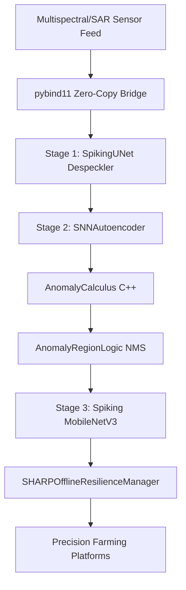
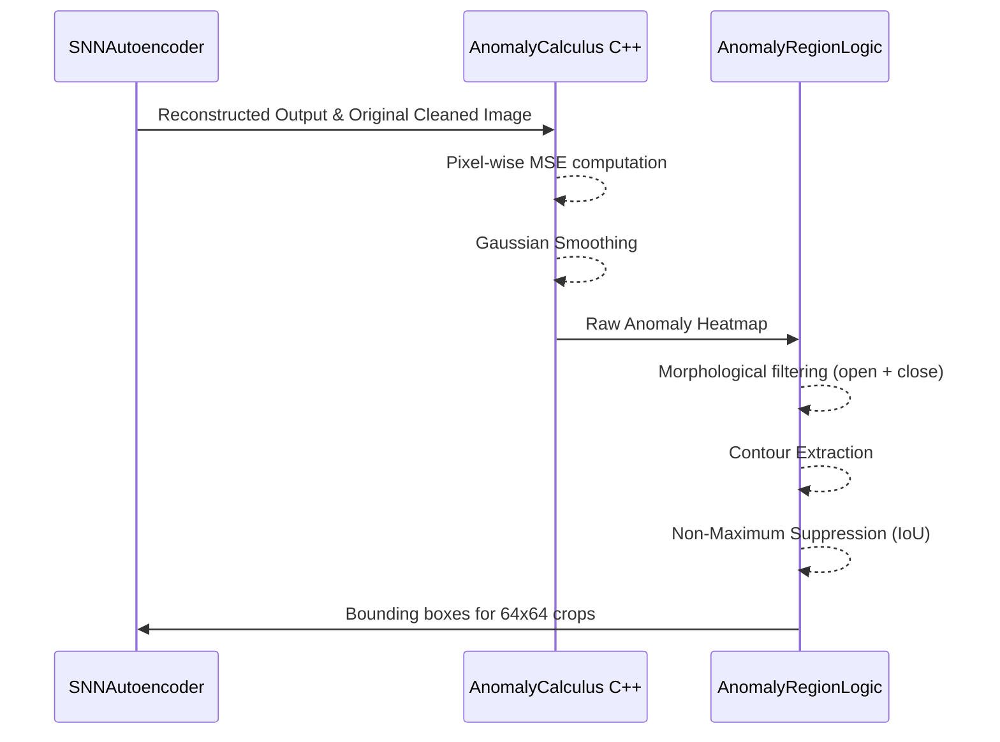

# Architecture: Drone-Based Precision Agriculture & Environmental Monitoring

> [!NOTE]
> This system deploys neuromorphic SNN architectures (S-UNet, SNNAutoencoder, Spiking MobileNetV3) for aerial agricultural monitoring. It leverages low-power, high-fps processing for drone edge compute (Jetson Orin Nano).

## System Workflow



## Stage 1: Aerial Image Despeckler
Repurposes **SpikingUNet (S-UNet)** (`models/despeckler/model.py`).
- Input is multispectral bands (RGB + NIR + RedEdge) or SAR.
- Uses `SpikingConvBlock` and `SpikingTransConvBlock` with LIF neurons (decay rate β=0.85).
- Output utilizes continuous V_mem readout to preserve field edge geometry and crop rows.
- Surrogate gradients (Fast Sigmoid, slope=25) used during training.

> [!CAUTION]
> The corruption engine (`models/despeckler/corruption.py`) must be correctly parameterized for drone vibration (motion blur) and atmospheric haze, not just SAR Rayleigh/Gamma noise unless processing Sentinel-1 feeds.

## Stage 2: Crop Health Anomaly Detector
Employs **SNNAutoencoder** (`models/autoencoder/autoencoder.py`).
- Trained strictly on healthy crop canopies (zero defects).
- Reconstructs healthy spectral signatures.



## Stage 3: Agricultural Anomaly Classifier
Repurposes **Spiking MobileNetV3**.
- Depthwise separable convolutions + LIF neurons.
- Processes 64x64 fixed input crops from Stage 2.
- Uses rate coding readout (spike count over T) with temperature scaling for calibrated probabilities.
- Cross-Entropy loss over 5 classes: Healthy Canopy, Fungal/Bacterial Disease, Pest Infestation, Water Stress, Weed Invasion.

## Key design decisions explained

| Decision | Rationale |
|---|---|
| Continuous V_mem readout in S-UNet | Preserves fine spatial geometry (crop rows, field boundaries) better than discrete spike accumulation for the despeckling stage. |
| Negative-only training for Autoencoder | Allows the system to detect any novel stressor (drought, new pests) without needing exhaustive labeled datasets for every anomaly type. |
| C++ AnomalyCalculus on edge | Lowers latency and power consumption by offloading pixel-wise MSE and smoothing to native code via pybind11 bridge (`cpp_extensions/anomaly_calculus/src/pybind_bridge.cpp`). |
| SHARPOfflineResilienceManager | Ensures no data is lost during drone flights in rural areas without cellular/WiFi; syncs telemetry to ground station upon landing. |

## Shared Infrastructure

| Component | Implementation File | Function |
|---|---|---|
| Zero-Copy Bridge | `cpp_extensions/anomaly_calculus/src/pybind_bridge.cpp` | `cv::Mat` ↔ numpy zero-copy via `py::array_t` for real-time frame processing. |
| Telemetry Buffer | `deployment/sharp_sync_daemon.py` | SQLite offline logging, background network heartbeat monitor, auto-sync. |
| Anomaly Region Logic | `deployment/anomaly_logic.py` | NMS, morphological filtering, and area-based contour extraction. |

## Export deliverables
- `sunet_despeckler_static_unrolled.onnx`: ONNX export of Stage 1 for TensorRT.
- `snn_autoencoder_static_unrolled.onnx`: ONNX export of Stage 2.
- `mobilenet_classifier_static_unrolled.onnx`: ONNX export of Stage 3.
- `tensorrt_calibration_dataset.npy`: Representative healthy crop frames for INT8 quantization calibration.
- `drone_deployment_validation.py`: Script to verify ≥10 FPS end-to-end throughput on Jetson Orin Nano.

> [!IMPORTANT]
> All SNN models must be exported using static temporal unrolling to be compatible with standard ONNX runtimes and TensorRT optimization on the Jetson edge platform.

## Suggested Project Structure

```text
precision_agriculture/
├── PRD.md
├── ARCHITECTURE.md
├── requirements.txt
├── data_prep/
│   ├── compute_vegetation_indices.py # NDVI, NDRE generation
│   ├── extract_patches.py            # Patch extraction
│   └── prepare_ucmerced.py           # Dataset preparation
├── models/
│   ├── despeckler/                   # Stage 1: S-UNet despeckler & corruption engine
│   ├── autoencoder/                  # Stage 2: SNNAutoencoder
│   └── classifier/                   # Stage 3: Spiking MobileNetV3 (planned)
├── deployment/
│   ├── anomaly_logic.py              # Spatial AnomalyRegionLogic & NMS
│   └── sharp_sync_daemon.py          # SHARPOfflineResilienceManager
└── cpp_extensions/
    └── anomaly_calculus/             # AnomalyCalculus C++ & pybind11 (agri_core)
```
