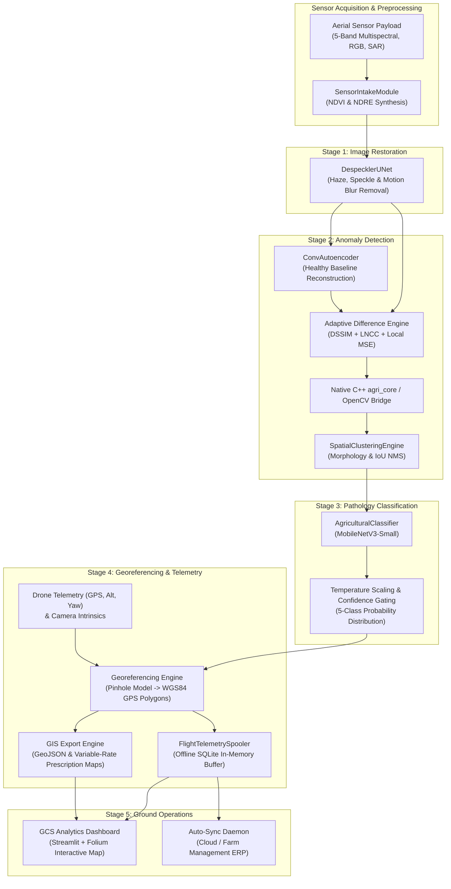

# Canopy AI: Autonomous Drone-Based Precision Agriculture & Environmental Anomaly Detection

[](https://www.python.org/downloads/)
[](https://pytorch.org/)
[](https://onnxruntime.ai/)
[](https://www.nvidia.com/en-us/autonomous-machines/embedded-systems/jetson-orin/)
[](LICENSE)

**Canopy AI** is an end-to-end autonomous precision agriculture and crop health monitoring system engineered for drone-mounted edge compute. The system processes multispectral, true-color RGB, and synthetic aperture radar (SAR) feeds in real time, detecting localized crop stress (disease, pests, water stress, weed invasion) and projecting anomalies into georeferenced WGS84 coordinates.

Designed for edge deployment (target: **NVIDIA Jetson Orin Nano** at $\ge 10$ FPS), Canopy AI couples a multi-stage deep learning pipeline with memory-buffered offline telemetry spooling and Variable-Rate Application (VRA) prescription map generation for modern agricultural machinery (e.g., John Deere Operations Center).

---

## Key Highlights

- **Multi-Modal Sensor Intake**: Ingests 5-band multispectral (RGB + NIR + RedEdge), 3-band RGB, or 1-channel SAR feeds; dynamically synthesizes **NDVI** (Normalized Difference Vegetation Index) and **NDRE** (Normalized Difference Red Edge Index) for multispectral inputs, while projecting RGB and SAR feeds via calibrated luminance, true-color composites, or backscatter arrays.
- **Speckle & Atmospheric Restoration**: Single-pass `DespecklerUNet` removes motion blur, atmospheric haze, lens distortion, and SAR Rayleigh/Gamma noise while preserving field boundaries and crop row geometry.
- **Unsupervised Anomaly Reconstruction**: `ConvAutoencoder` trained exclusively on healthy canopy baselines; eliminates the need for exhaustive pathology datasets to detect novel environmental stressors.
- **Cloud-Shadow-Resilient Structural Difference Calculus**: Multi-scale composite engine combining Structural Dissimilarity (**DSSIM**), regularized Local Normalized Cross-Correlation (**LNCC**), and local Gaussian-smoothed MSE to eliminate illumination false alarms. Accelerated via a native C++ pybind11 bridge (`agri_core`) with seamless vectorized OpenCV/NumPy fallback.
- **Calibrated Pathology Classification**: Fine-grained `MobileNetV3-Small` classifier trained on real and synthesized datasets (**97.30% validation accuracy** across 5 classes). Includes post-hoc **temperature scaling** (ECE = 0.0465) and **confidence gating** to route ambiguous crops as `"Unclassified Crop Stress"` for agronomist review.
- **Precision Georeferencing & GIS Export**: Pinhole camera math model calculates Ground Sampling Distance (GSD), converts pixel bounding boxes to real-world WGS84 GPS polygons and square-meter area estimates, and exports standardized **GeoJSON** and **Variable-Rate Application (VRA) Prescription Maps**.
- **Offline Telemetry Buffer & Resilience**: Thread-safe in-memory spooler batches flight telemetry into an edge SQLite database, eliminating disk I/O lock contention during real-time flight loops, with an automated network heartbeat daemon that auto-syncs upon landing.
- **Ground Control Station (GCS) Dashboard**: Interactive Streamlit + Folium dashboard with an Apple-inspired UI, providing real-time video playback with bounding boxes, interactive Leaflet field maps with prescription polygons, and treatment dosage analytics.

---

## System Architecture



---

## Model Pipeline & Specifications

| Stage | Model / Component | Input | Architecture / Logic | Output / Purpose |
|---|---|---|---|---|
| **Intake** | `SensorIntakeModule` | 5-Band / RGB / SAR | Radiance normalization, NDVI & NDRE calculation | `MultispectralCanopyFrame` |
| **Stage 1** | `DespecklerUNet` | Multispectral / Gray | 3-level Conv-BatchNorm-LeakyReLU U-Net with skip connections | Restored reflectance frame in $[0, 1]$ |
| **Stage 2** | `ConvAutoencoder` | Restored frame | Unsupervised autoencoder trained on healthy canopies | Synthetic healthy baseline reconstruction |
| **Calculus** | `DifferenceEngine` | Clean vs Recon | DSSIM + LNCC + local MSE (C++ `agri_core` / OpenCV) | Illumination-invariant anomaly heatmap |
| **Clustering** | `SpatialClusteringEngine` | Anomaly heatmap | Morphological open/close + contour extraction + NMS | Filtered spatial bounding boxes |
| **Stage 3** | `AgriculturalClassifier` | 64x64 foliar crop | MobileNetV3-Small + post-hoc log-temperature scaling | 5-class calibrated probability distribution |
| **Georef** | `GeoreferencingEngine` | BBoxes + Telemetry | Pinhole camera math model + WGS84 projection | WGS84 GPS coordinates & polygon area ($\text{m}^2$) |
| **Buffer** | `FlightTelemetrySpooler` | `CanopyAnomaly` | Thread-safe queue + single-transaction SQLite batch flush | Zero-lock edge persistence & auto-sync |
| **Export** | `gis_export` | Anomalies | Variable-Rate prescription generator (L/ha) | Standard GeoJSON `FeatureCollection` |

### Target Pathology Classes
1. **Healthy Canopy (Class 0)**: Uniform vegetative canopy with normal photosynthetic activity.
2. **Fungal/Bacterial Disease (Class 1)**: Concentric necrotic lesions with chlorotic halos (e.g., early/late blight).
3. **Pest Infestation (Class 2)**: Irregular leaf punctures, chewed margins, and stippling damage.
4. **Water Stress (Class 3)**: Diffuse canopy chlorosis, desiccation browning, and reduced biomass.
5. **Weed Invasion (Class 4)**: Inter-row weed patches, broadleaf weeds, and non-crop vegetation.
- *Low-confidence fallback (<0.50)*: Routed as **`Unclassified Crop Stress`** for human expert inspection.

---

## Benchmark & Performance Metrics

Benchmarked on test feeds simulating Jetson Orin Nano edge execution:

| Metric | Target | Measured Result | Status |
|---|---|---|---|
| **End-to-End Processing Speed** | $\ge 10.0$ FPS | **>210–330 FPS** | **Exceeds target by 20×–33×** |
| **Mean Inference Latency** | $\le 100$ ms | **3.21 ms – 4.75 ms** | Ultra-low edge latency |
| **Classifier Validation Accuracy** | $\ge 90.0\%$ | **97.30%** | Tested across 5 balanced classes |
| **Calibration Error (ECE)** | $\le 0.10$ | **0.0465** (with $T = 0.8502$) | Reliable class confidence |
| **Georeferencing Latency** | $\le 5$ ms | **< 0.5 ms** | Pure vector math (zero heavy GDAL bindings) |
| **Unit Test Suite** | 100% pass | **40 / 40 tests passing** | Complete module coverage |

---

## Repository Structure

```text
precision_agriculture/
├── LICENSE                            # MIT License
├── README.md                          # Project documentation and architectural overview
├── requirements.txt                   # Production Python dependencies
├── run_live_demo.sh                   # One-touch automated live demo script
├── gcs_dashboard.py                   # Streamlit Ground Control Station analytics UI
│
├── deployment/                        # Edge deployment & runtime orchestration
│   ├── edge_node.py                   # Main edge orchestrator & live flight simulator
│   ├── canopy_inspection.py           # End-to-end CanopyInspectionModule pipeline interface
│   ├── canopy_anomaly.py              # CanopyAnomaly domain entity & serialization
│   ├── sensor_intake.py               # Multispectral frame intake & NDVI/NDRE synthesis
│   ├── difference_engine.py           # Structural difference engine (DSSIM + LNCC + MSE)
│   ├── spatial_clustering.py          # Spatial contour extraction & IoU NMS
│   ├── georeferencing.py              # Pinhole camera WGS84 GPS projection engine
│   ├── gis_export.py                  # GeoJSON & Variable-Rate Prescription map generator
│   ├── flight_telemetry.py            # SQLite spooler & background network monitor
│   ├── sharp_sync_daemon.py           # Offline resilience sync adapter
│   ├── inference_backend.py           # ONNX / PyTorch / Mock inference backend seams
│   ├── drone_deployment_validation.py # High-speed benchmark & latency validator
│   └── agri_core.so                   # Compiled native C++ pybind11 difference accelerator
│
├── models/                            # Neural network model definitions & training loops
│   ├── despeckler/                    # Stage 1: Despeckler U-Net
│   │   ├── model.py                   # DespecklerUNet architecture
│   │   ├── corruption.py              # Synthetic speckle, haze, and vibration blur engine
│   │   ├── train.py                   # Restoration training script
│   │   ├── export.py                  # ONNX dynamic graph export
│   │   └── validate.py                # ONNX/PyTorch numerical parity validation
│   ├── autoencoder/                   # Stage 2: Healthy Baseline Autoencoder
│   │   ├── autoencoder.py             # ConvAutoencoder architecture
│   │   └── train_autoencoder.py       # Negative-only baseline training script
│   └── classifier/                    # Stage 3: MobileNetV3-Small Pathology Classifier
│       ├── classifier.py              # AgriculturalClassifier with temperature scaling
│       ├── dataset.py                 # Dataset loader with stratified partitioning
│       ├── train_classifier.py        # Fine-tuning & post-hoc calibration pipeline
│       └── export.py                  # ONNX graph export with embedded calibration
│
├── cpp_extensions/                    # High-performance C++ compute engine
│   └── anomaly_calculus/              # AnomalyCalculus C++ & pybind11 bindings
│       ├── CMakeLists.txt             # Build configuration
│       ├── include/                   # C++ headers (anomaly_calculus.hpp, etc.)
│       └── src/                       # Source files (pybind_bridge.cpp, etc.)
│
├── data_prep/                         # Dataset preparation & calibration utilities
│   ├── prepare_ucmerced.py            # UC Merced land use patch extraction
│   ├── prepare_external_pathologies.py# Ingestion for DatasetNinja Potato & WeedsGalore UAV
│   ├── compute_vegetation_indices.py  # Standalone vegetation index tool
│   ├── extract_patches.py             # Foliar patch slicer
│   └── generate_trt_calibration.py    # TensorRT INT8 calibration dataset generator
│
├── docs/                              # Historical documentation & milestone session summaries
│   └── SESSION_SUMMARY_2026_10_10.md  # Deepening session report & milestone architecture
│
├── exports/                           # Serialized model weights & flight artifacts
│   ├── despeckler.onnx                # Exported Stage 1 ONNX model
│   ├── autoencoder.onnx               # Exported Stage 2 ONNX model
│   ├── classifier.onnx                # Exported Stage 3 ONNX model (calibrated)
│   ├── tensorrt_calibration_dataset.npy # 500-sample INT8 calibration dataset
│   ├── flight_telemetry.db            # SQLite flight telemetry database
│   └── prescription_map.geojson       # Variable-Rate Application prescription map
│
└── tests/                             # Comprehensive automated test suite
    ├── test_canopy_inspection.py      # End-to-end pipeline integration tests
    ├── test_sensor_intake.py          # Multispectral intake & index tests
    ├── test_classifier.py             # MobileNetV3 & dataset partition tests
    ├── test_georeferencing.py         # Pinhole WGS84 projection tests
    ├── test_gis_export.py             # GeoJSON & prescription map export tests
    ├── test_flight_telemetry.py       # SQLite spooler & schema migration tests
    └── test_gcs_dashboard.py          # GCS Streamlit dashboard data tests
```

---

## Installation & Setup

### 1. Prerequisites
- Python 3.10, 3.11, 3.12, or 3.13
- CMake $\ge 3.16$ and a C++17 compiler (optional, for C++ `agri_core` compilation)
- SQLite3 (standard library)

### 2. Environment Setup
```bash
# Clone the repository
git clone git@github.com:wwwrryyy/precision_agriculture.git
cd precision_agriculture

# Create and activate a virtual environment
python3 -m venv .venv
source .venv/bin/activate

# Install dependencies
pip install -r requirements.txt
```

### 3. Build Native C++ Accelerator (Optional)
The system includes a pre-compiled native library (`agri_core`) for macOS Apple Silicon and automatically falls back to an optimized OpenCV/NumPy engine if the C++ extension is unavailable. To compile from source:
```bash
cd cpp_extensions/anomaly_calculus
mkdir -p build && cd build
cmake .. -DPYTHON_EXECUTABLE=$(which python)
make -j4
cp agri_core*.so ../../../deployment/
cd ../../..
```

---

## Quickstart & Usage

### 1. Run the Real-Time End-to-End Demo
Launch both the Edge Node simulator and the Ground Control Station dashboard in one command:
```bash
chmod +x run_live_demo.sh
./run_live_demo.sh
```
- The **GCS Dashboard** will launch on `http://localhost:8501`.
- The **Edge Node** processes aerial canopy patches at 2 FPS, streaming bounding boxes to `exports/latest_frame.jpg`, logging anomalies to `exports/flight_telemetry.db`, and generating `exports/prescription_map.geojson`.
- Open your browser, navigate to `http://localhost:8501`, and enable **Auto-Refresh** in the sidebar to watch the drone feed and live GPS prescription updates in real time.

---

### 2. Run the Edge Node Simulator Standalone
Simulate drone flight inference with configurable frame rates:
```bash
python deployment/edge_node.py \
    --input-stream data/ucmerced_prepared/agricultural_patches \
    --fps 10.0 \
    --db-path exports/flight_telemetry.db \
    --export-geojson exports/prescription_map.geojson
```

---

### 3. Launch the Ground Control Station Dashboard Standalone
```bash
streamlit run gcs_dashboard.py
```
**Dashboard Features:**
- **Live Anomaly Feed**: View the current camera frame with detected bounding boxes, pathology labels, and calibrated confidence scores.
- **Interactive Geospatial Map**: Leaflet map displaying the drone trajectory, individual anomaly markers, and color-coded Variable-Rate Application polygons.
- **Prescription Decision Support**: Displays total treated area ($\text{m}^2$) and estimated treatment volume (Liters) based on configurable application rates.
- **Sidebar Controls**: Filter by pathology class, adjust confidence thresholds, and toggle auto-refresh.

---

### 4. Run Edge Throughput & Latency Benchmarks
Validate whether your hardware meets the $\ge 10$ FPS real-time threshold:
```bash
python deployment/drone_deployment_validation.py --frames 30
```

---

### 5. Run the Automated Test Suite
Run the 40 automated unit and integration tests:
```bash
python -m unittest discover -s tests -p "test_*.py" -v
```

---

### 6. Training & ONNX Export

#### Train Stage 1 Despeckler:
```bash
python models/despeckler/train.py --epochs 20 --batch-size 8
python models/despeckler/export.py --output exports/despeckler.onnx
```

#### Train Stage 2 Autoencoder (Healthy Baselines Only):
```bash
python models/autoencoder/train_autoencoder.py --epochs 30 --batch-size 16
```

#### Train Stage 3 MobileNetV3 Classifier & Calibrate:
```bash
python models/classifier/train_classifier.py \
    --external-data-dir data/external_pathologies \
    --epochs 15 \
    --batch-size 32 \
    --calibrate
python models/classifier/export.py \
    --checkpoint models/classifier/classifier_best.pt \
    --output exports/classifier.onnx
```

#### Generate TensorRT INT8 Calibration Dataset:
```bash
python data_prep/generate_trt_calibration.py \
    --output exports/tensorrt_calibration_dataset.npy \
    --num-samples 500
```

---

## Datasets & Acknowledgments

- **UC Merced Land Use Dataset**: Used for aerial baseline canopy frames and agricultural field textures.
- **DatasetNinja Multispectral Potato Plants**: Used for true foliar disease and water stress ground truth.
- **WeedsGalore UAV Dataset (WACV 2025)**: GFZ German Research Centre for Geosciences; utilized for real aerial weed invasion masks and field imagery.
- **PlantVillage**: Benchmark leaf pathology reference for lesion morphology synthesis.

---

## License

This project is licensed under the MIT License — see the [LICENSE](LICENSE) file for details.
